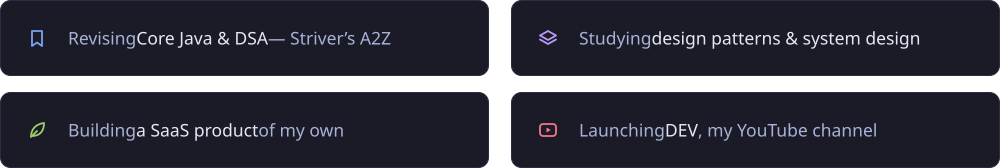

<!-- Custom images (monitor, Currently cards) are generated by assets/src/build.py. Everything else is a live widget. -->


<p align="center">
  
</p>

<p align="center">
  
  
  
  
</p>

## About me


```java
class Rohit {
  String   role     = "Backend Engineer";
  int      years    = 11;
  String   location = "Mumbai, India";
  String[] stack    = {"Java", "Spring Boot",
                       "Hibernate", "MySQL"};
  String[] across   = {"Backend", "Full-stack",
                       "Mobile", "AI/ML"};
  String   offline  = "Video editing & motion graphics";
}
```

## Tech stack

<p align="center">
  
  &nbsp;&nbsp;&nbsp;
  
  <br />
  <sub>Java · Spring Boot · Spring · Hibernate · MySQL &nbsp;|&nbsp; Premiere Pro · After Effects</sub>
</p>

## Currently



## GitHub analytics

<p align="center">
  
  
</p>

<p align="center">
  
</p>

<p align="center">
  
</p>

<p align="center">
  
</p>

<p align="center">
  <picture>
    <source media="(prefers-color-scheme: dark)" srcset="https://raw.githubusercontent.com/RohitBavkar/RohitBavkar/output/github-snake-dark.svg" />
    <source media="(prefers-color-scheme: light)" srcset="https://raw.githubusercontent.com/RohitBavkar/RohitBavkar/output/github-snake.svg" />
    
  </picture>
</p>

<!-- Connect with me: hidden until the links are filled in.
<h2 align="center">Connect with me</h2>

<p align="center">
  <a href="YOUTUBE_URL"></a>
  <a href="LINKEDIN_URL"></a>
  <a href="PORTFOLIO_URL"></a>
  <a href="mailto:EMAIL"></a>
</p>
-->


