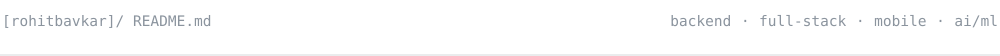
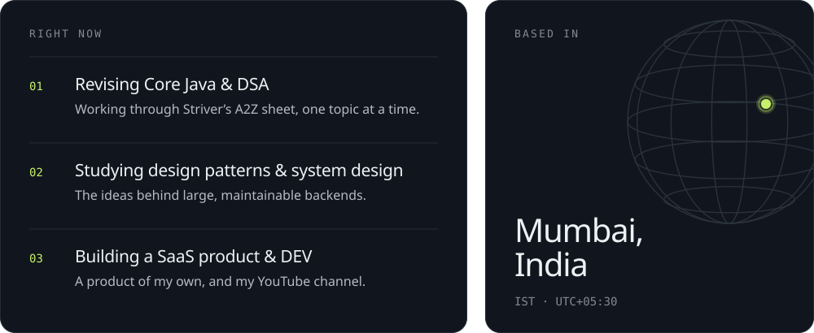
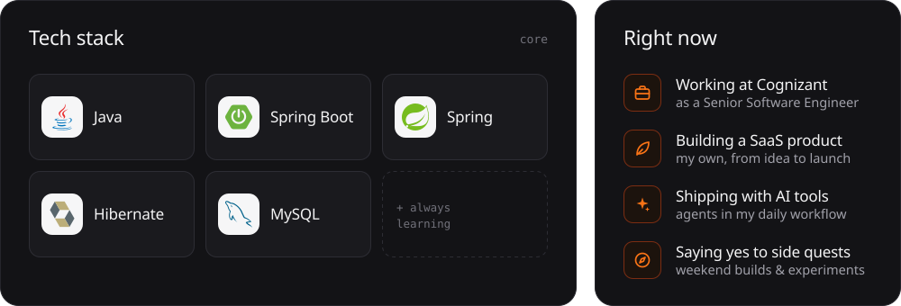
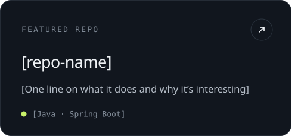
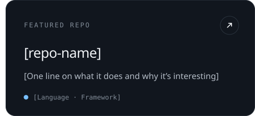

<!-- Visual rows are generated by assets/src/build.py. Edit the content there, re-run it, and commit the SVGs. -->

<!-- Featured repos: hidden until the two repos are chosen.

-->

<!-- Contact buttons: hidden until the links are filled in.

-->
